  <picture>
    <source media="(prefers-color-scheme: dark)" srcset="assets/dashboard-dark.svg" />
    
  </picture>

  Founder &amp; product engineer at <a href="https://www.evoqstudioke.com"><b>Evoq Studio</b></a>, Nairobi.
  Building <a href="https://github.com/Asta39/zeno"><b>Zeno</b></a> — accounting, CRM &amp; payroll for Kenyan businesses.

  <a href="https://github.com/Asta39/zeno">Zeno</a> ·
  <a href="https://github.com/Asta39/snowdock">snowdock</a> ·
  <a href="https://github.com/Asta39/mavuno">mavuno</a> ·
  <a href="https://github.com/Asta39/property-management">property-management</a> ·
  <a href="https://www.evoqstudioke.com">evoqstudioke.com</a>

  <picture>
    <source media="(prefers-color-scheme: dark)" srcset="https://raw.githubusercontent.com/Asta39/Asta39/output/snake-dark.svg" />
    
  </picture>

Dashboard refreshes daily from live GitHub data.

